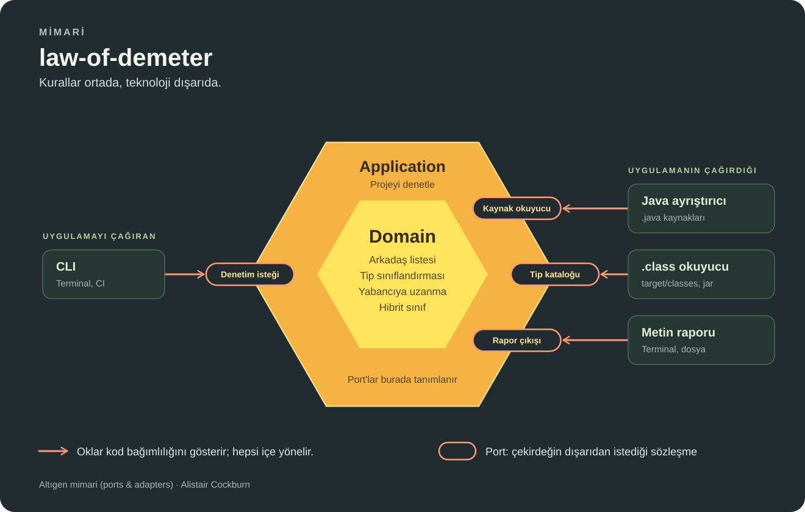

# Law of Demeter

Kaynak kodda Law of Demeter ihlallerini bulan bir araç. Kodu tip bilgisiyle birlikte okur ve kuralı çiğneyen her çağrıyı nedeniyle raporlar.

Şu anda Java'yı destekliyor: Java kaynağını derlenmiş sınıflarla birlikte okur. Python, Rust gibi diller ileride eklenecek.

## Ajanlar için

Araç, kod yazan her ajana sınır koymak için yazıldı: yapay zekâ ajanlarına, süper zekâya (Super Intelligence) ve insan ajanlara. Ajan kod yazarken aracı çalıştırır, kuralı çiğneyen çağrıları rapordan görür ve düzeltir.

- **Çıkış kodu sınırı çizer:** İhlal ya da hibrit sınıf varsa araç 1 ile çıkar. Ajan bu sonucu başarısız bir test gibi ele alır.
- **Rapor nedenini söyler:** Her ihlal satırı dosyayı, satırı, çağrıyı ve çiğnenen kuralı gösterir. Ajan neyi neden düzelteceğini buradan öğrenir.

Kurulum, komut, seçenekler ve çıkış kodları [Kullanım](#kullanım) bölümünde.

## Neden Law of Demeter?

Bir metot başka nesnelerin içine uzandıkça daha çok şeye bağımlı olur. `order.getCustomer().getWallet().withdraw(amount)` yazan metot yalnızca siparişi değil, müşteriyi ve cüzdanı da tanır. Aradaki yapı değişince o da değişir.

Law of Demeter bu bağımlılığı sınırlar: metot yalnızca yakın çevresindeki nesnelerle konuşur.

- **Değişiklik yerinde kalır:** Bir nesnenin iç yapısı değişince yalnızca onu doğrudan kullananlar etkilenir; değişiklik zincir boyunca projeye yayılmaz.
- **Kapsülleme korunur:** Nesne verisini dışarı vermez, işi kendisi yapar. Kontroller tek yerde, verinin sahibinde kalır.
- **Test kolaylaşır:** Metot yalnızca arkadaşlarını kullandığı için testte sahte nesne döndüren sahte nesneler kurmak gerekmez.
- **Kod kolay okunur:** Metodu anlamak için uzaktaki sınıfların iç yapısını bilmek gerekmez.

Zincirleri gözle aramak büyük projede zordur ve her zincir ihlal değildir: veri yapısında, akıcı zincirde ya da Java koleksiyonlarında zincir serbesttir. Araç bu ayrımı derlenmiş sınıflardan okuduğu tip bilgisiyle yapar.

## Kural

<details>
<summary><strong>Law of Demeter nedir?</strong></summary>

Kural iki kısaltmayla anlatılır:

- **C:** Bir sınıf.
- **f:** C sınıfındaki bir metot.

f yalnızca şu nesnelerin metotlarını çağırabilir:

- C'nin kendisi
- f'nin içinde oluşturulan bir nesne
- f'ye argüman olarak verilen bir nesne
- C'nin bir alanında tutulan nesne

f, bu nesnelerin döndürdüğü nesnelerin metotlarını çağırmaz. Kısaca: arkadaşlarınla konuş, yabancılarla konuşma.

Örneklerde C `OrderService` sınıfı, f de `pay` metodu.

<details>
<summary><strong>Uygun değil</strong></summary>

```java
class OrderService {
    void pay(Order order, Money amount) {
        order.getCustomer().getWallet().withdraw(amount);
    }
}
```

Zincirdeki her çağrı ayrı değerlendirilir:

1. `order.getCustomer()`: Serbest. `order`, f'ye argüman olarak verildi.
2. `.getWallet()`: Kuralı çiğner. Bu metot, `getCustomer()`'ın döndürdüğü müşteride çağrılıyor ve müşteri listede yok.
3. `.withdraw(amount)`: Kuralı çiğner. Bu metot, `getWallet()`'ın döndürdüğü cüzdanda çağrılıyor ve cüzdan da listede yok.

Sonuç: `pay`, siparişin bir müşterisi, müşterinin de bir cüzdanı olduğunu bilmek zorunda. Cüzdanın yeri değişirse `pay` de değişir.

</details>

<details>
<summary><strong>Uygun</strong></summary>

```java
class OrderService {
    void pay(Order order, Money amount) {
        order.charge(amount);
    }
}
```

1. `order.charge(amount)`: Serbest. `order`, f'ye argüman olarak verildi.

Sonuç: f yalnızca argümanıyla konuşuyor. Müşteriye ve cüzdana nasıl ulaşılacağını `Order` biliyor.

</details>

</details>

## Veri yapıları

Kural nesneler içindir. Nesne verisini gizler ve davranışını açar. Veri yapısı ise verisini açar ve davranış taşımaz. İki durumu da karıştırmamak gerekir.

<details>
<summary><strong>Hibrit sınıf</strong></summary>

Hem verisini açan hem davranış taşıyan sınıfa hibrit denir. Örneklerde C `PaymentService` sınıfı, f de `pay` metodu.

<details>
<summary><strong>Uygun değil</strong></summary>

```java
class Account {
    private int balance;

    int getBalance() {
        return balance;
    }

    void setBalance(int balance) {
        this.balance = balance;
    }

    void withdraw(int amount) {
        if (amount > balance) {
            throw new IllegalStateException("Insufficient balance");
        }
        balance -= amount;
    }
}

class PaymentService {
    void pay(Account account, int amount) {
        account.setBalance(account.getBalance() - amount);
    }
}
```

1. `account.getBalance()`: Serbest. `account`, f'ye argüman olarak verildi.
2. `account.setBalance(...)`: Serbest, ama `Account` verisini `getBalance()` ve `setBalance()` ile açıyor, bir yandan da `withdraw()` davranışını taşıyor. Araç sınıfı hibrit olarak raporlar.

Sonuç: `pay`, `withdraw()` içindeki bakiye kontrolünü atlıyor; bakiye eksiye düşebilir. Alanları dışarıdan değiştirilebildiği için hibrit sınıf kendi kuralını koruyamaz.

</details>

<details>
<summary><strong>Uygun</strong></summary>

```java
class Account {
    private int balance;

    void withdraw(int amount) {
        if (amount > balance) {
            throw new IllegalStateException("Insufficient balance");
        }
        balance -= amount;
    }
}

class PaymentService {
    void pay(Account account, int amount) {
        account.withdraw(amount);
    }
}
```

1. `account.withdraw(amount)`: Serbest. `account`, f'ye argüman olarak verildi.

Sonuç: `Account` bakiyesini gizliyor. Kontrol tek yerde, verinin sahibinde kalıyor; sınıf hibrit sayılmaz.

</details>

</details>

<details>
<summary><strong>Veri yapısında zincirle okumak</strong></summary>

Veri yapısında zincirle okumak kuralı çiğnemez, çünkü gizlenecek bir iç yapı yoktur. Aynı zincir davranış taşıyan nesnelerden geçerse çiğner. Örneklerde C `Connector` sınıfı, f de `portOf` metodu.

<details>
<summary><strong>Uygun değil</strong></summary>

```java
class Server {
    private int port = 8080;

    int port() {
        return port;
    }

    void restart() {
    }
}

class Config {
    private final Server server = new Server();

    Server server() {
        return server;
    }

    void reload() {
    }
}

class Connector {
    int portOf(Config config) {
        return config.server().port();
    }
}
```

1. `config.server()`: Serbest. `config`, f'ye argüman olarak verildi.
2. `.port()`: Kuralı çiğner. Bu metot, `server()`'ın döndürdüğü sunucuda çağrılıyor. `Server` davranış taşıyan bir nesne (`restart()`) ve listede yok.

Sonuç: `portOf`, yapılandırmanın bir sunucusu, sunucunun da bir portu olduğunu bilmek zorunda. `Server` değişirse `portOf` de değişir.

</details>

<details>
<summary><strong>Uygun</strong></summary>

```java
record Server(String host, int port) {
}

record Config(Server server) {
}

class Connector {
    int portOf(Config config) {
        return config.server().port();
    }
}
```

1. `config.server()`: Serbest. `config`, f'ye argüman olarak verildi.
2. `.port()`: Serbest. `server()`'ın döndürdüğü `Server` bir veri yapısı; yalnızca veri taşıyor.

Sonuç: `portOf` aynı kalıyor. `Config` ve `Server` davranış taşımadığı için yapılarını açmaları beklenen bir durum.

</details>

</details>

## Akışlar, lambdalar ve statik importlar

Akış, lambda ya da metot referansı yabancıyla konuşmayı gizlemez. Araç elemanların nereden geldiğini izler ve zincirle aynı kararı verir. Her örnek, ihlalin düzeltilmiş hâliyle birlikte durur: nesneye sormak yerine ona söylenir. Tam liste [SCENARIOS.md](SCENARIOS.md)'de.

Örneklerde `Order`, `Customer` ve `Wallet` davranış taşıyan nesnelerdir. `Order` müşterisini, `Customer` de cüzdanını `getCustomer()` ve `getWallet()` ile verir.

<details>
<summary><strong>Akışın yabancıdan ürettiği elemanla konuşmak</strong></summary>

Örneklerde C `BillingService` sınıfı, f de `charge` metodu.

<details>
<summary><strong>Uygun değil</strong></summary>

```java
class BillingService {
    private final List<Order> orders = new ArrayList<>();

    void charge(Money amount) {
        orders.stream().map(order -> order.getCustomer()).forEach(customer -> customer.getWallet().withdraw(amount));
    }
}
```

1. `orders.stream()`: Serbest. `orders`, C'nin bir alanı.
2. `.map(order -> order.getCustomer())`: Serbest. `order`, `orders`'ın elemanı; arkadaş.
3. `.forEach(...)`: Serbest. Akış bir Java konteyneri.
4. `customer.getWallet()`: Kuralı çiğner. `customer`, `getCustomer()`'ın döndürdüğü müşteri ve listede yok.
5. `.withdraw(amount)`: Kuralı çiğner. Bu metot, `getWallet()`'ın döndürdüğü cüzdanda çağrılıyor.

Sonuç: Akış yabancıyı gizlemez; `order.getCustomer().getWallet().withdraw(amount)` ile aynı ihlal.

</details>

<details>
<summary><strong>Uygun</strong></summary>

```java
class BillingService {
    private final List<Order> orders = new ArrayList<>();

    void charge(Money amount) {
        orders.forEach(order -> order.charge(amount));
    }
}
```

1. `orders.forEach(...)`: Serbest. `orders`, C'nin bir alanı.
2. `order.charge(amount)`: Serbest. `order`, `orders`'ın elemanı; arkadaş.

Sonuç: `BillingService` yalnızca siparişlerle konuşuyor. Müşteriye ve cüzdana nasıl ulaşılacağını `Order` biliyor.

</details>

</details>

<details>
<summary><strong>Yabancıyla metot referansıyla konuşmak</strong></summary>

Örneklerde C `BalanceService` sınıfı, f de `balances` metodu.

<details>
<summary><strong>Uygun değil</strong></summary>

```java
class BalanceService {
    private final List<Order> orders = new ArrayList<>();

    List<Integer> balances() {
        return orders.stream().map(Order::getCustomer).map(Customer::getWallet).map(Wallet::getBalance).toList();
    }
}
```

1. `orders.stream()`: Serbest. `orders`, C'nin bir alanı.
2. `.map(Order::getCustomer)`: Serbest. Siparişler arkadaş.
3. `.map(Customer::getWallet)`: Kuralı çiğner. Referans, `customer -> customer.getWallet()` ile aynı çağrıyı yapar; müşteriler `getCustomer()`'dan gelen yabancılar.
4. `.map(Wallet::getBalance)`: Kuralı çiğner. Cüzdanlar `getWallet()`'tan gelen yabancılar.
5. `.toList()`: Serbest. Akış bir Java konteyneri.

Sonuç: Metot referansı lambdayla aynı yargılanır; `Order::getCustomer` siparişte çağrıldığı için uygun, sonraki ikisi uygun değil.

</details>

<details>
<summary><strong>Uygun</strong></summary>

```java
class BalanceService {
    private final List<Order> orders = new ArrayList<>();

    List<Integer> balances() {
        return orders.stream().map(Order::balance).toList();
    }
}
```

1. `orders.stream()`: Serbest. `orders`, C'nin bir alanı.
2. `.map(Order::balance)`: Serbest. Referans siparişte çağrılıyor; arkadaş.
3. `.toList()`: Serbest. Akış bir Java konteyneri.

Sonuç: Bakiyeyi nasıl bulacağını `Order` biliyor; `BalanceService` müşteriyi ve cüzdanı tanımıyor.

</details>

</details>

<details>
<summary><strong>Gruplanan anahtarla konuşmak</strong></summary>

Örneklerde C `CustomerService` sınıfı, f de `activate` metodu.

<details>
<summary><strong>Uygun değil</strong></summary>

```java
class CustomerService {
    void activate(List<Order> orders) {
        for (Customer buyer : orders.stream().collect(Collectors.groupingBy(Order::getCustomer)).keySet()) {
            buyer.activate();
        }
    }
}
```

1. `orders.stream().collect(Collectors.groupingBy(Order::getCustomer)).keySet()`: Serbest. `orders`, f'ye argüman olarak verildi; `Order::getCustomer` siparişlerde çağrılıyor.
2. `buyer.activate()`: Kuralı çiğner. Haritanın anahtarlarını `Order::getCustomer` üretiyor; `buyer`, `getCustomer()`'dan gelen yabancı.

Sonuç: Gruplama yabancıyı gizlemez; `order.getCustomer().activate()` ile aynı ihlal.

</details>

<details>
<summary><strong>Uygun</strong></summary>

```java
class CustomerService {
    void activate(List<Order> orders) {
        orders.forEach(Order::activateCustomer);
    }
}
```

1. `orders.forEach(...)`: Serbest. `orders`, f'ye argüman olarak verildi.
2. `Order::activateCustomer`: Serbest. Referans siparişte çağrılıyor; arkadaş.

Sonuç: Müşteriyi etkinleştirmeyi `Order` yapıyor; `CustomerService` müşteriye uzanmıyor.

</details>

</details>

<details>
<summary><strong>Haritanın değerleriyle ve girdileriyle konuşmak</strong></summary>

Örneklerde C `ReportingService` sınıfı, f'ler `activateByOrder` ve `rewardBuyers` metotları.

<details>
<summary><strong>Uygun değil</strong></summary>

```java
class ReportingService {
    void activateByOrder(List<Order> orders) {
        for (Customer buyer : orders.stream().collect(Collectors.toMap(Order::getId, Order::getCustomer)).values()) {
            buyer.activate();
        }
    }

    void rewardBuyers(List<Order> orders, int bonus) {
        for (Map.Entry<Customer, Order> entry : orders.stream().collect(Collectors.toMap(Order::getCustomer, order -> order)).entrySet()) {
            entry.getKey().getWallet().deposit(bonus);
            entry.getValue().ship();
        }
    }
}
```

1. `activateByOrder`: `toMap(...).values()` serbest; `orders`, f'ye argüman olarak verildi.
2. `buyer.activate()`: Kuralı çiğner. Değer eşleyici `Order::getCustomer` yabancı verdiği için `values()` yabancı verir.
3. `rewardBuyers`: `toMap(...).entrySet()` ve `entry.getKey()` serbest; `entry`, `orders`'tan geliyor.
4. `.getWallet()`: Kuralı çiğner. Anahtar eşleyici `Order::getCustomer`, yani anahtarlar yabancı.
5. `.deposit(bonus)`: Kuralı çiğner. Bu metot, `getWallet()`'ın döndürdüğü cüzdanda çağrılıyor.
6. `entry.getValue().ship()`: Serbest. Değer eşleyici `order -> order` elemanı olduğu gibi verir; sipariş arkadaş.

Sonuç: Harita yabancıyı gizlemez. Anahtarın ve değerin durumu ayrı izlenir: yabancı olan anahtar ve değer ihlal sayılır, sipariş olan değer sayılmaz.

</details>

<details>
<summary><strong>Uygun</strong></summary>

```java
class ReportingService {
    void activateByOrder(List<Order> orders) {
        orders.forEach(Order::activateCustomer);
    }

    void rewardBuyers(List<Order> orders, int bonus) {
        for (Order order : orders) {
            order.reward(bonus);
            order.ship();
        }
    }
}
```

1. `orders.forEach(...)`: Serbest. `orders`, f'ye argüman olarak verildi.
2. `Order::activateCustomer`: Serbest. Referans siparişte çağrılıyor; arkadaş.
3. `order.reward(bonus)` ve `order.ship()`: Serbest. `order`, `orders`'ın elemanı; arkadaş.

Sonuç: Müşteriye ve cüzdana `Order` ulaşıyor. `ReportingService` haritaya ve girdilere hiç ihtiyaç duymuyor.

</details>

</details>

<details>
<summary><strong>Kuruculara verilen lambdayla konuşmak</strong></summary>

Örneklerde C `DiscountService` sınıfı, f de `discountLines` metodu. `Batch`'in kurucusu `List<T>` ile `Consumer<T>` alır ve lambdayı listenin elemanlarına uygular.

<details>
<summary><strong>Uygun değil</strong></summary>

```java
class DiscountService {
    void discountLines(Order order) {
        new Batch<>(order.getLines(), line -> line.applyDiscount(10));
    }
}
```

1. `order.getLines()`: Serbest. `order`, f'ye argüman olarak verildi.
2. `line.applyDiscount(10)`: Kuralı çiğner. Lambdanın girdisi listenin elemanları; onları `getLines()` verdiği için yabancı. Lambda yeni oluşturulan `Batch`'i değil, o elemanları alır.

Sonuç: İndirim kuralı `Order`'ın dışına, `DiscountService`'e dağılıyor; `order.getLines().forEach(line -> line.applyDiscount(10))` ile aynı ihlal.

</details>

<details>
<summary><strong>Uygun</strong></summary>

```java
class DiscountService {
    void discountLines(Order order) {
        order.applyDiscount(10);
    }
}
```

1. `order.applyDiscount(10)`: Serbest. `order`, f'ye argüman olarak verildi.

Sonuç: İndirimi satırlara nasıl uygulayacağını `Order` biliyor.

</details>

</details>

<details>
<summary><strong>Statik importla gelen çağrının sonucuyla konuşmak</strong></summary>

Örneklerde C `GuestService` sınıfı, f de `deposit` metodu. `guest()`, `Defaults` sınıfının statik metodu.

<details>
<summary><strong>Uygun değil</strong></summary>

```java
import static shop.Defaults.*;

class GuestService {
    void deposit(int amount) {
        guest().getWallet().deposit(amount);
    }
}
```

1. `guest()`: Serbest. `Defaults`'tan yıldızlı statik importla geliyor; statik çağrının sonucu arkadaş.
2. `.getWallet()`: Serbest. Bu metot, arkadaş olan `guest()` sonucunda çağrılıyor.
3. `.deposit(amount)`: Kuralı çiğner. `getWallet()`, `Customer`'ın alanını döndürür ve o cüzdan listede yok.

Sonuç: İmport çağrının nereden geldiğini gizler ama kararı değiştirmez; `guest().getWallet().deposit(amount)` ile `order.getCustomer().getWallet().withdraw(amount)` aynı ihlal.

</details>

<details>
<summary><strong>Uygun</strong></summary>

```java
import static shop.Defaults.*;

class GuestService {
    void deposit(int amount) {
        guest().deposit(amount);
    }
}
```

1. `guest()`: Serbest. Statik çağrının sonucu arkadaş.
2. `.deposit(amount)`: Serbest. Bu metot, arkadaş olan `guest()` sonucunda çağrılıyor.

Sonuç: Cüzdana `Customer` ulaşıyor; `GuestService` cüzdanı tanımıyor.

</details>

</details>

## Kullanım

Araç repo kökünden kurulur:

```bash
cargo install --path crates/cli
```

Araç, Java kaynağını ve derlenmiş sınıfları birlikte okur. Lombok'un ürettiği metotlar yalnızca derlenmiş sınıflarda göründüğü için proje önce derlenir.

```bash
mvn -q compile dependency:build-classpath -Dmdep.outputFile=classpath.txt
```

```bash
law-of-demeter --source src/main/java --classpath "$(cat classpath.txt):target/classes"
```

- **`-s`, `--source`:** Denetlenecek kaynak kökü; birden çok verilebilir. Çok modüllü projede bütün modüllerin kökleri verilir, yoksa diğer modüllerin tipleri kütüphane sayılır.
- **`-c`, `--classpath`:** Derlenmiş sınıf dizinleri ve jar'lar; birden çok verilebilir, `:` ile ayrılmış liste de olur.
- **`--show-allowed`:** Uygun çağrıları da uydukları kuralla gösterir.
- **`--jdk-home`, `--release`:** JDK'yı ve sürümünü seçer. Verilmezse `JAVA_HOME` ya da `PATH`'teki `javac` kullanılır.
- **`-h`, `--help`:** Kullanımı gösterir.

Çıkış kodu 0 ise ihlal yoktur, 1 ise ihlal ya da hibrit sınıf vardır, 2 ise kullanım hatası vardır ya da kaynak kökü veya JDK bulunamamıştır. Okunamayan dosyalar ve çözülemeyen tipler raporda listelenir ama çıkış kodunu değiştirmez.

### Örnek

Küçük bir proje düşün: Kural bölümündeki `OrderService` ile Veri yapıları bölümündeki hibrit `Account` ve `PaymentService`, bir de `Order`, `Customer`, `Wallet` ve `Money` sınıfları `src/shop` altında dursun. Proje `javac` ile derlenir ve araçtan geçirilir:

```bash
javac -d out $(find src -name '*.java')
```

```bash
law-of-demeter --source src --classpath out
```

<details>
<summary><strong>Örnek çıktı</strong></summary>

```text
İhlaller (2):
src/shop/OrderService.java:5  shop.OrderService.pay  getWallet()  İhlal: getCustomer() çağrısının döndürdüğü nesne f'nin arkadaşı değil
src/shop/OrderService.java:5  shop.OrderService.pay  withdraw()  İhlal: getWallet() çağrısının döndürdüğü nesne f'nin arkadaşı değil

Hibrit sınıflar (1):
src/shop/Account.java  shop.Account  Hibrit sınıf: davranış: withdraw; setter: setBalance

Özet:
  Dosya: 7
  Metot: 13
  Çağrı: 7 (uygun 5, ihlal 2, belirsiz 0)
  Hibrit sınıf: 1
  Kaynak hatası: 0
  Tip okuma hatası: 0

İhlal nedenleri:
  2  Döndürülen nesne f'nin arkadaşı değil
```

Her ihlal satırı dosyayı ve satırı, sınıfı ve metodu, çağrıyı ve nedeni gösterir. İhlal ya da hibrit sınıf olduğu için araç 1 ile çıkar. `--show-allowed` ile uygun çağrılar da uydukları kuralla listelenir.

</details>

Daha büyük bir örnek repodaki `examples/shop` projesidir. Raporu [beklenen raporda](examples/shop/expected-report.txt) durur ve `--show-allowed` ile üretilmiştir. Örnek projeleri Maven ile derleyip araçtan geçirmek için (Maven, JDK ve ısınmış `~/.m2` gerekir): `cargo test -p law-of-demeter-cli --test examples -- --ignored`

## Mimari

<details>
<summary><strong>Katmanlar ve port'lar</strong></summary>

Proje altıgen mimariyle (ports & adapters) yazılır. Kural ortadaki domain'de durur. Domain hiçbir dili bilmez; Java'yı, dosyaları ve ayrıştırıcıyı yalnızca adapter'lar bilir.



| Katman | Sorumluluk |
|---|---|
| **Domain** | Kuralın kendisi: arkadaş listesi, bir tipin veri yapısı, nesne, hibrit, değer ya da konteyner olarak sınıflandırılması, yabancıya uzanma ve hibrit sınıf. Her çağrı için kararı ve nedenini verir. Dosya okumaz, hiçbir dilin tip kuralını ve adını bilmez. |
| **Application** | "Projeyi denetle" kullanım senaryosu. Domain kurallarını yürütür; dışarıdan istediklerini port'larla ister. |
| **Adapter** | Port'ları gerçek teknolojiye bağlar: komut satırı, Java ayrıştırıcı, `.class` okuyucu ve rapor. |

| Port | Ne sağlar | Adapter |
|---|---|---|
| Denetim isteği | Denetlenecek kaynaklar ve derlenmiş sınıflar | CLI |
| Kaynak okuyucu | Metotlar ve çağrıları; her çağrının hedefinin nereden geldiği: parametre, alan, `new` ya da başka bir çağrının dönüşü. Okurken tip kataloğunu alır: tip şekilleri ve platform. Tipleri de kendisi çözer: aşırı yükleme, generic çıkarım, değişken sayıda argüman, lambda ve metot referansı tipleri, veri akışı bağları. Çözümü çağrıların, lambdaların ve metot referanslarının köprü alanlarıyla domain'e verir. | Java ayrıştırıcı |
| Tip kataloğu | Bir tipin alanları ve metotları, Lombok'un ürettikleri dahil; dilin platformu: standart kütüphanesinden bilinen değer, konteyner ve veri yapısı tipleri, kök ve davranışsız üst tipleri, nesne ve eşitlik metotları, kurucu adı, builder metodu, iç tip ayracı ve değiştirici metot adları | `.class` okuyucu; platform için Java ayrıştırıcının Java platformu |
| Rapor çıkışı | Bulgular: dosya, satır ve çiğnenen kural. Kullanıcı isterse uygun çağrılar da uydukları kuralla birlikte. | Metin raporu |

Bağımlılık yalnızca içe doğru akar: adapter → application → domain. Domain verinin hangi yoldan geldiğini bilmez. Bu yüzden domain testleri Java dosyası olmadan yazılır.

Domain hiçbir dili bilmez. Dile özgü her şey, yani tip kuralları ve dilin değerleri adapter'dadır: Java ayrıştırıcı bunları çözer ve Java platformunu kurar. Domain'in dile özgü bir bilgiye ihtiyacı olursa köprü alanı eklenir ve alanı adapter doldurur. Yeni bir dil eklemek için yeni bir adapter crate'i yazılır: kendi kaynak okuyucusu, tip çözümlemesi ve platformu olur; domain değişmez. Bu kural bir testle korunur: domain üretim kodunda dil adı geçerse test kırılır.

Her katman ayrı bir crate'tir: `core` domain ve application'ı, `class-file` ve `java-source` adapter'ları taşır; `cli` hepsini bağlar. Bağımlılık yönünü derleyici korur.

<details>
<summary><strong>Örnek: bir çağrının yolu</strong></summary>

```java
class OrderService {
    void pay(Order order, Money amount) {
        order.getCustomer().getWallet().withdraw(amount);
    }
}
```

1. **Kaynak okuyucu:** `withdraw`, `getWallet()`'ın dönüşünde çağrılıyor. `getWallet()`, `getCustomer()`'ın dönüşünde; `getCustomer()` da `order` parametresinde çağrılıyor.
2. **Tip kataloğu:** `Wallet`'ın `withdraw` davranışı var.
3. **Domain:** `Wallet` bir nesne ve f'nin arkadaşı değil. Kural çiğneniyor.
4. **Rapor çıkışı:** Bulgu `OrderService.java` dosyasının 3. satırı için yazılır.

</details>

</details>

## Kaynaklar

- **Law of Demeter:** Karl Lieberherr ve Ian Holland, *Assuring Good Style for Object-Oriented Programs*, IEEE Software, 1989.
- **Veri yapıları ve hibrit sınıflar:** Robert C. Martin, *Clean Code*, 6. bölüm.
- **Altıgen mimari:** Alistair Cockburn, [Hexagonal Architecture](https://alistair.cockburn.us/hexagonal-architecture).
